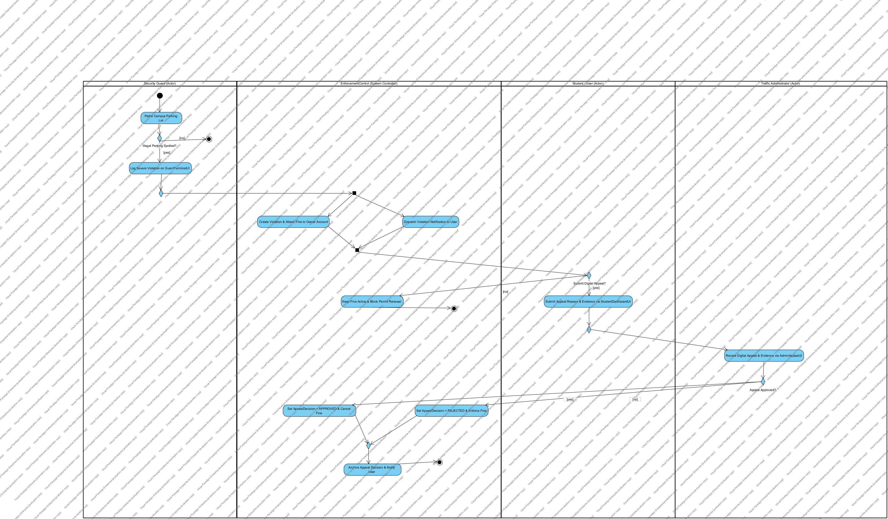
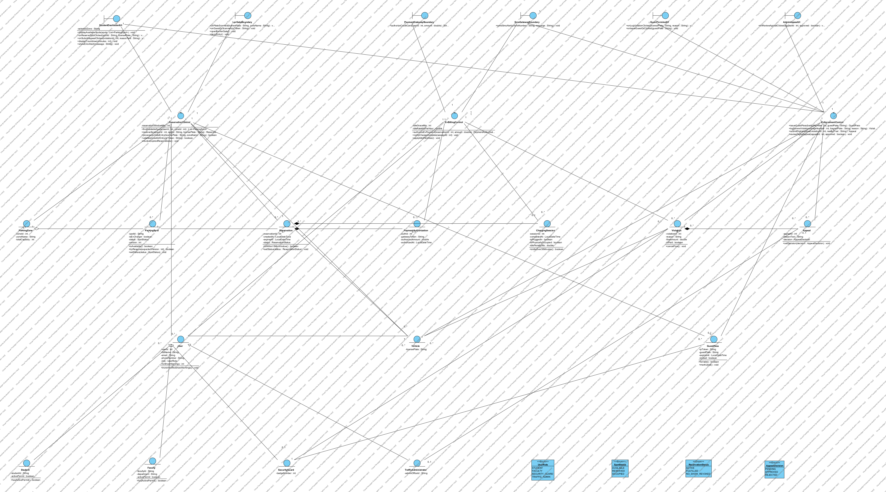
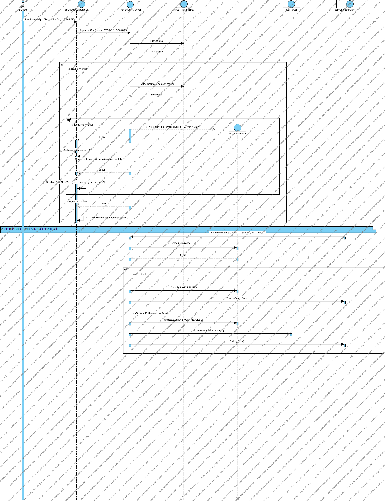
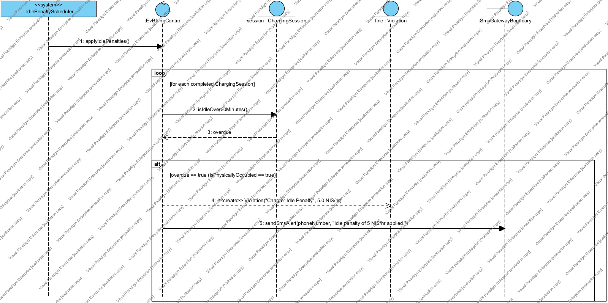

# System Architecture & Object-Oriented Design (`Ex4_SmartParking_Design`)

**Course:** 61756 Software Engineering Methods (Academic Year 2026-2027)
**Institution:** ORT Braude College of Engineering | Department of Software Engineering
**Domain:** Smart Campus Parking, LPR, and EV Network (Continued from Exercise 1)

---

## 1. Engineering Team Details

| Role | Full Name | Student ID | Braude Academic Email |
| :--- | :--- | :--- | :--- |
| **Student (Role A + Role B, individual submission)** | `AS REQUEST` | `AS REQUEST` | `AS REQUEST` |

* **Group / Submission Name:** `AS REQUEST` (individual submission)
* **GitHub Repository URL:** `https://github.com/Oratias07/Ex4_SmartParking_Design`

---

## 2. Step 1: Business Process Modeling — Activity Diagram (`Visual Paradigm`)

* **PlantUML Source:** [`diagrams/activity_appeal.puml`](diagrams/activity_appeal.puml)
* **Visual Paradigm Model:** [`SystemModel_Ex4.vpp`](SystemModel_Ex4.vpp)
* **Partitions / Swimlanes:** Separates external **Actors** (`Security Guard`, `Student / User`, `Traffic Administrator`) from the internal **System Controller** (`EnforcementControl`), using `initial node`, `fork`/`join` (AND), `decision` (XOR) with explicit `[guards]`, `merge` (OR), and `activity final node`.



---

## 3. Step 2: Structural Modeling — ECB Class Diagram (`PlantUML` -> `Visual Paradigm`)

Following the **ECB (Entity-Control-Boundary)** architectural pattern (ECB Component Responsibility Table):

| ECB Stereotype | Classes in System | Architectural Responsibility |
| :--- | :--- | :--- |
| **`<<boundary>>`** | `StudentDashboardUI`, `GuardTerminalUI`, `AdminAppealUI`, `LprGateBoundary`, `PaymentGatewayBoundary`, `SmsGatewayBoundary` | Interfaces with external Actors and external hardware/payment/SMS systems. Communicates ONLY with `<<control>>` classes. |
| **`<<control>>`** | `ReservationControl`, `EvBillingControl`, `EnforcementControl` | Multiple specialized controllers orchestrating business rules, timers, concurrency checks, and workflows. |
| **`<<entity>>`** | `User` (`Student`, `Faculty`, `SecurityGuard`, `TrafficAdministrator`), `GuestPass`, `Vehicle`, `ParkingZone`, `ParkingSpot`, `Reservation`, `PaymentAuthorization`, `ChargingSession`, `Violation`, `Appeal` + 4 UML `enum`s | Passive domain data classes storing persistent business state and domain helper methods. |

* **PlantUML Source:** [`diagrams/class_diagram_ecb.puml`](diagrams/class_diagram_ecb.puml)
* **Visual Paradigm Model:** [`SystemModel_Ex4.vpp`](SystemModel_Ex4.vpp)



---

## 4. Step 3: Behavioral Modeling — ECB Sequence Diagrams (`PlantUML` -> `Visual Paradigm`)

### 4.1 Sequence Diagram 1: Spot Reservation, LPR Gate Entry & No-Show Destruction
* **PlantUML Source:** [`diagrams/sequence_reservation_ecb.puml`](diagrams/sequence_reservation_ecb.puml)



### 4.2 Sequence Diagram 2: EV Charging 30-Minute Idle Penalty (`loop` & `<<create>>`)
* **PlantUML Source:** [`diagrams/sequence_idle_penalty_ecb.puml`](diagrams/sequence_idle_penalty_ecb.puml)



---

## 5. Independent AI Prompt & Architectural Design Critique (Part 4)

```text
You are a senior software architect reviewing a UML design. Use the attached SYSTEM_STORY.md as the only source of requirements, and audit the attached diagrams/class_diagram_ecb.puml and diagrams/sequence_reservation_ecb.puml against the two edge cases in Section 3 of SYSTEM_STORY.md:
Edge Case A (Double-Booking Race Condition): two students click Reserve on the last available spot in the Student Zone at the exact same millisecond.
Edge Case B (Physical vs. Electrical EV State): an EV driver unplugs the charging cable at minute 29 but does not move the car out of the EV bay.
For each edge case: (1) state whether the current Class Diagram and Sequence Diagram already handle it, and point to the exact class, attribute, operation or alt fragment that does; (2) describe the concrete failure if it is not handled; (3) propose the minimal UML change (attribute, operation, association or sequence message) that fixes it.
Then list any other inconsistency you find between the Sequence Diagram messages and the Class Diagram operations, or any business rule from SYSTEM_STORY.md that is missing from the diagrams.
Keep the ECB rules: boundary classes talk only to control classes, and only inheritance uses an arrow. Answer as a numbered list, without regenerating the full diagrams.
```

* **Improvement 1 Applied (Race Condition):** Added `version: int` and `tryReserve(expectedVersion: int): boolean` on `ParkingSpot` (and nested `alt acquired == true/false` in Sequence Diagram 1) to prevent simultaneous double-booking.
* **Improvement 2 Applied (EV Physical Occupancy):** Separated `isPluggedIn` from `isPhysicallyOccupied` on `ChargingSession` so unplugging the cable at minute 29 without moving the car still triggers the 30-minute Charger Idle Penalty.
* **Additional Improvement 3 (No-Show warning):** Sequence Diagram 1 now calls `user.incrementNoShowWarnings()` in the No-Show branch before `destroy res`, as required by Section 2.2 of SYSTEM_STORY.md (the `user : User` lifeline was added).
* **Additional Improvement 4 (Iterative refinement):** Added the association `EvBillingControl "1" -- "0..*" User : notifies`, so the controller can reach the user's `phoneNumber` used in `sendSmsAlert(phoneNumber, ...)` in Sequence Diagram 2.

---

## 6. License
Distributed under the **ORT Braude College Academic License** (61756 Software Engineering Methods, 2026-2027).
